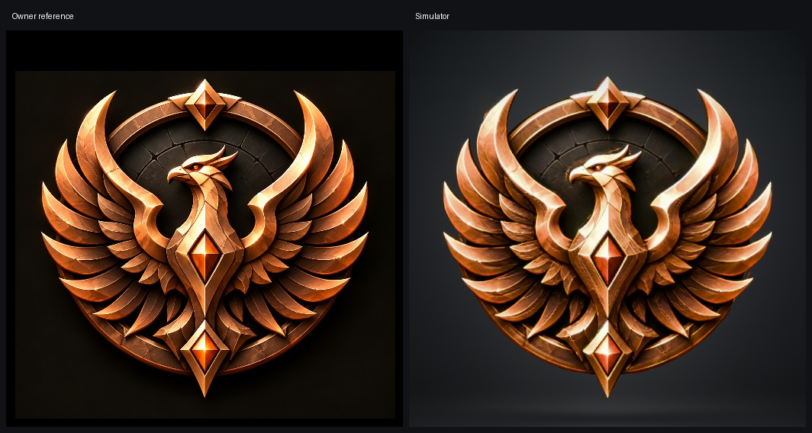

# Bronze Phoenix

Selected candidate03. [Final USDZ](mobile/phoenix_badge_mobile.usdz) and [complete editable Blender scene](phoenix.blend).

Traced the owner's bronze phoenix, swept feather silhouette, circular bronze frame, recessed cracked center, head and tail. Built raised feather vanes and a matching sculpted rear. All three amber diamonds have closed geometry and four real primary planes on each face. Their bezels meet smooth recesses without a stepped height cut.

The bronze and amber facets have real moving studio reflections. The bronze uses a gentler polished finish with broad highlights, informed by the owner's sword feedback. Native light measurements balance those reflections against the reference colors. Reference fill preserves the small metal marks, stone cracks, amber glow and fine face detail. Some reference highlights therefore remain fixed. The model is a sculpted relief; the single front picture does not define a fully independent rear design or unseen depth.

Checked the complete model in the connected Blender application from front, both sides and back. Checked the native simulator at rest, early rotation, back and both sides, plus a slow full turn. Enlarged outline captures and the full turn recording are saved in candidate03. The USDZ is closed, uses UsdPreviewSurface and CrestUV, Y up, one meter per unit, identity transforms, with no lights, cameras, floor or coin material names. The ARKit USD checker passed.

This is a custom floating medallion rather than the standard coin shell: the wings and tail extend beyond its circular frame in the reference. Its lowest point is Y minus 2.455, highest 3.015, width 5.606, preview size 1 and lift 0. Its back and thickness are centered on the spin axis.

The model has 87,168 triangles and is 7.77 MB. This exceeds the usual size guidance to keep the detailed feather outlines, depth and matching rear. Main maps are 1024 pixels and gem maps are 512. The reference's deliberate fractured metal texture, bright outer highlights and lower feather detail are retained instead of removing those details to meet general finish guidance. Physical device loading time is unmeasured.

Only a separate entry in the existing private Badge Studio preview was added. The production app and existing badge models were not edited. Open Choose badge and select Bronze Phoenix.
