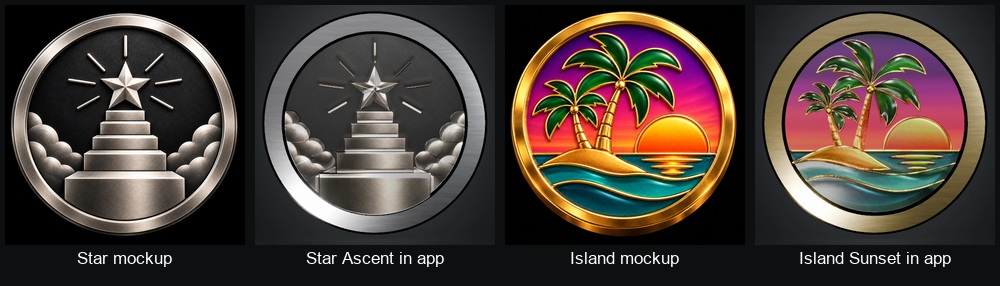

# October 16 coin prototypes

**Star Ascent** and **Island Sunset** are selectable under **Choose Badge** in the separate **Badge Coins Preview** simulator. They use the approved complete circular shell, protruding flat brushed rim and shared floating placement, with matching raised backs. No existing tier was replaced.



Star Ascent has five machined steps, a faceted star, seven rays and rounded overlapping clouds. Island Sunset has hand-traced palm fronds, segmented trunks, a raised island and wave borders over recessed sunset and sea surfaces. These are sculpted interpretations of the mockups, not exact copies of every contour. Lighting differs from the mockups because the approved studio and rim finish are preserved.

The first app views were washed out. Relief materials were fitted against measured Home illumination; the rims were excluded completely. The sunset's final pass smooths its intrinsic gradient and improves emission-map precision. Metal relief and rims use zero emission. Every rim vertex, normal, UV, material graph and referenced texture file is unchanged from its approved source.

| Model | File size | Triangles | Relief meshes |
|---|---:|---:|---:|
| Star Ascent | 2.54 MB | 22,604 | 6 |
| Island Sunset | 3.49 MB | 39,882 | 10 |

Disconnected pieces sharing a material were consolidated without changing their geometry. Island's initial 150-entity calibration exceeded the app's six-second loading deadline; the consolidated final loads with the original deadline. Diagnostic timeout/logging changes were removed exactly.

Both USDZ files pass Apple's ARKit USD checker. `validate.py` confirms the source rims and their maps are unchanged, shells are closed, transforms are identity, units are meters with Y up, there are no cameras or lights, and there are no degenerate triangles or zero normals. Details are in `validation.json` and each `model.json`.

Both final coins passed a slow full turn and complete front, back and both side outline checks at 4x. No broken outer silhouette or external bloom puff was observed. Both picker entries work; Island Sunset is left at Home rest. The original five preview model files still match their canonical checksums.

Preview build proof:

```text
ScreenTime-UIOnly: ** BUILD SUCCEEDED **
```

This is a private simulator preview, not production integration. The production `screen_time` repo is unchanged. No production build/test gate or device performance measurement is claimed. Existing badge assets are preserved. Sources, packed Blender scenes and final USDZ files are here; capture videos and intermediate renders remain in `/tmp`, with no Downloads review pack.
