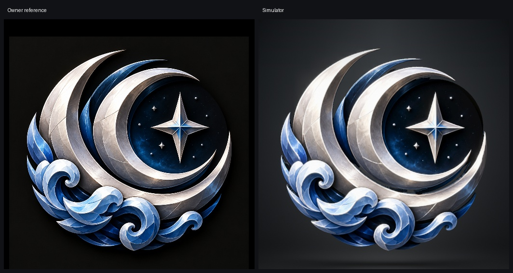

# Crescent Ocean

Selected candidate06. Final model: [USDZ](mobile/crescent_ocean_badge_mobile.usdz). Complete editable Blender source: [crescent_ocean.blend](crescent_ocean.blend).

Traced the silver and blue crescent contours, star field and breaking waves. The compass has real main facet planes. Removed detached background fragments and sealed small gaps in dark metal.

Checked the complete model in the connected Blender application from the front, both sides and rear. The native Badge Studio preview was built successfully. Checked its front, back, both side poses and a slow full turn, including the floor reflection. Enlarged outline captures are saved with the candidate. The exported surface is closed, uses identity transforms, Y up and one meter per unit. The ARKit USD checker passed.

This is a custom floating shape, with its lowest point at Y = minus 2.455 and its highest at 3.015. Preview size is 1 and lift is 0. The model carries no camera, lights or floor and uses CrestUV with UsdPreviewSurface materials.

The reference finish uses detailed surface maps with the preview's AgX transform inverted. Most face highlights stay fixed to preserve the reference appearance; the side metal and a small face contribution reflect the studio lights. Fine scratches, smaller facet reflections and engraving are surface detail on the sculpted relief. The back repeats the sculpting and materials. Side and rear depth are inferred from the single front reference. Side normals use a smooth contour field and a front to rear blend to remove the raster contour's reflection bands while retaining the geometry.

The file contains 95,784 triangles and is 8.51 MB, above the usual badge size guidance to preserve these detailed outlines and relief. Main finish maps are 1024 pixels; the separate compass maps are 512 pixels. Reference texture is retained through the lowest part to preserve the waves, stone and blade detail. Physical device load time is unmeasured.

Production app files and existing badge finals were not edited. This model is installed only as a separate entry in Badge Studio on the dedicated preview simulator.
